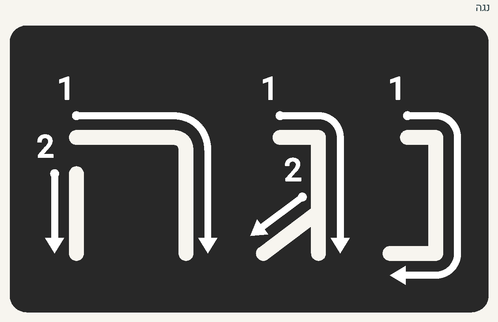
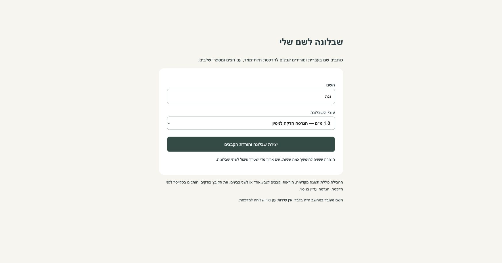
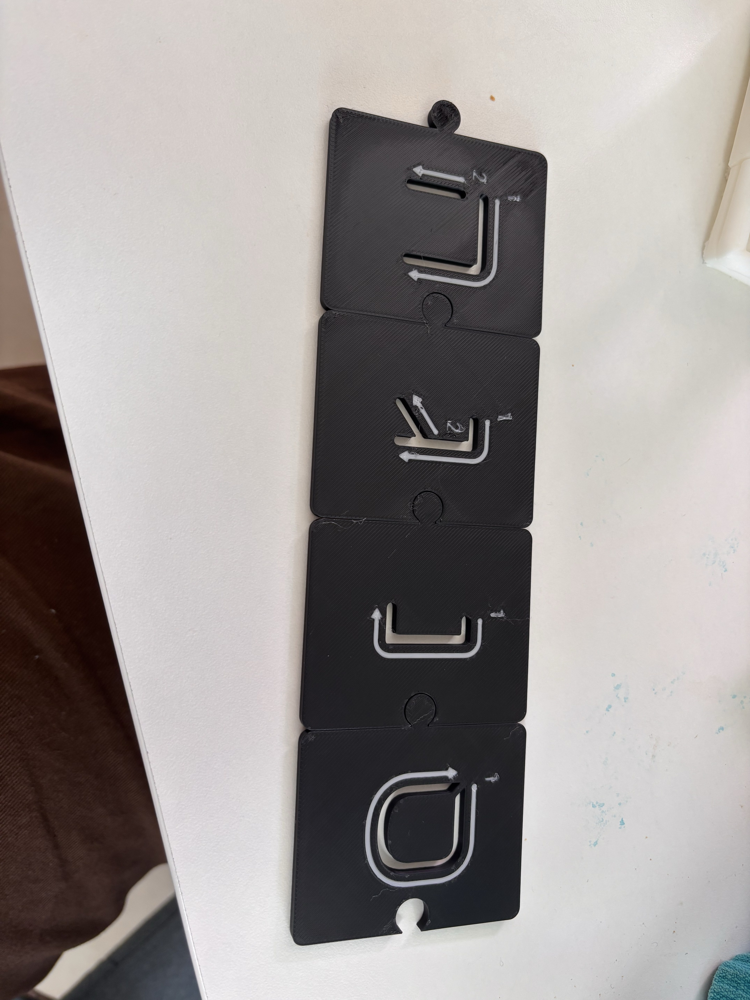

# שבלונות עברית להדפסת תלת־ממד

אותיות מתחברות ושבלונות של שמות שלמים, עם פתח לכתיבה וחצים ומספרי שלבים על החומר שלצדו.
אפשר להדפיס בצבע אחד עם סימונים שקועים, או בשני צבעים עם מילוי הסימונים.

**גרסת שיתוף ניסיונית — 22.10.2026.** הגאומטריה נבדקת במחשב; נוחות הכתיבה והעמידות עדיין דורשות משוב פיזי.



## להוריד ולהדפיס

- [חבילת הפרויקט המלאה להורדה](https://github.com/SapirCZ/hebrew-name-stencils/releases/download/v0.1.0/hebrew-stencils-project-2026-10-22.zip) — גרסה ניסיונית v0.1.0.
- [דוגמה מוכנה: נגה](examples/noga/) — `DUAL_COLOR.3mf` לשני צבעים או `SINGLE_COLOR.3mf` לצבע אחד.
- [כל 27 אריחי הדפוס](downloads/print_alphabet/) — כולל חמש הסופיות, קבצים נפרדים לכל אות.
- [תצוגת כל אותיות הדפוס](docs/print_card_stencil_review_v8.jpg).
- [מה מוכן ומה פתוח](STATUS_HE.md), [הוראות הדפסה](docs/PRINT_HE.md), [יצירת שם חדש](docs/NAMES_HE.md).
- [המחקר והגרסאות הקודמות](archive/README_HE.md) — כולל 54 אותיות הנדסיות מגופנים: דפוס וכתב.

ב־GitHub אפשר להוריד את המאגר דרך **Code → Download ZIP**. אין צורך להתקין Python כדי להדפיס קובץ מוכן.

## ליצור שבלונה לשם חדש

נדרש Python 3.11 ומעלה. הפיתוח והבדיקות המקומיות בוצעו ב־Python 3.14.

מתוך תיקיית הפרויקט:

```sh
python3 -m venv .venv
.venv/bin/python -m pip install -r requirements.txt
.venv/bin/python src/name_app.py
```

ייפתח טופס בעברית בדפדפן: מזינים שם, בוחרים עובי ומורידים ZIP עם השבלונה.
המחולל עובד במחשב המקומי, ללא חשבון וללא שליחה למדפסת.



ב־Windows, יצירת הסביבה היא `py -m venv .venv`; בהמשך מחליפים את `.venv/bin/python` ב־`.venv\Scripts\python.exe`.

אפשר גם משורת הפקודה:

```sh
.venv/bin/python src/stencils.py --name "נגה" --output my-stencil
.venv/bin/python src/stencils.py --name "חן אור" --thickness 2.4 --output my-output
```

השם נשמר מימין לשמאל. יש להזין את צורת האות הסופית הרצויה; המחולל אינו מחליף אותיות אוטומטית.
נתמכות אותיות עבריות ורווחים, ללא ניקוד. שם שרחב מ־240 מ״מ נדחה עם הודעה לפצל אותו לשתי שבלונות.

## מה עדכני בפרויקט

**דפוס:** צורת האות וסדר המשיכות מגיעים מנתיבי הכרטיסיות שנבחרו בפרויקט, ומיקומי החצים מסקירת v8.
אלה אינם קווי המתאר של Heebo. הפונט Heebo משמש לספרות. המשך חץ 1 במ׳ נכלל.

**שמות:** כל המילה על רצועה רציפה; ללא מחברי פאזל בין האותיות. העובי ההתחלתי 1.8 מ״מ,
עם סימונים בעומק 0.6 מ״מ ורצפה של 1.2 מ״מ. אפשר לבחור 2.4 או 3.2 מ״מ.
מיקום האותיות שומר על קו הבסיס של גרסת v16; גובה הרצועה יכול לגדול עבור סופיות וסימונים.

**אריחים:** גוף 52×62 מ״מ, עובי 2.4 מ״מ, מחבר פאזל יחיד בכל צד. רוחב הגוף עם הלשונית 60.3 מ״מ.
ההרכבה נעשית מלמעלה. אין מנגנון נעילה בכיוון הגובה.

**כתב:** נשמרו דגמי ההנדסה ההיסטוריים המבוססים על גברת לוין, ללא חצים לכל האלפבית.
סט כתב לימודי מלא ומאושר הוא משימה פתוחה; מחולל השמות החדש משתמש בדפוס בלבד.

### הדפסה פיזית ראשונה



הצילום מציג את הפיילוט הראשון, לפני שיפורי הגימור והספרות. הוא מתעד את מנגנון הפאזל
ואת הפתחים והחצים, וגם את בעיות הספרות והמחבר שהובילו לניסוי ההשוואה.
אין לראות בו אישור פיזי לגרסת השיתוף הדקה או לפרופיל המשולב החדש.

## פרופיל ההדפסה בחבילה

פרויקטי ה־3MF כוללים P1S, דיזה 0.4 מ״מ, Textured PEI ו־Generic PLA רגיל.
הגוף בפילמנט 1 והסימונים בפילמנט 2. בגרסת הצבע האחד קיים גוף שקוע בלבד ואין מגדל ניקוי.
יש לפתוח כ־**Open Project** כדי לשמור את שיוך החלקים וההגדרות.

שכבה 0.20 מ״מ, משטח עליון 60 מ״מ/ש׳, Arachne וגיהוץ עליון: מהירות 30, זרימה 10%, ריווח 0.15 מ״מ.
הספרות מעובות ב־0.12 מ״מ לכל צד. זהו שילוב מועמד שנבחר מהשוואת גרסאות 4 ו־5;
**השילוב והעובי 1.8 מ״מ טרם קיבלו אישור פיזי מתועד.** הוא אינו כיול אוניברסלי למדפסות ולחומרים אחרים.

## מבנה ושחזור

```text
src/stencils.py           מחולל שמות ואריחי דפוס
src/name_app.py           טופס מקומי להורדת שבלונה
src/generate.py           כלי גאומטריה וייצוא ששימשו בפרויקט
data/review/             צורות ונתיבי ההדרכה שנבדקו
profiles/                פרופיל מועמד, ללא פרטי חיבור למדפסת
fonts/                   Heebo וגברת לוין עם רישיונות OFL
examples/noga/           דוגמת שם מוכנה
downloads/print_alphabet/ 27 אריחי דפוס עדכניים
archive/                 מחקר, מקורות וגרסאות הנדסיות קודמות
tests/                   בדיקות משמעותיות של המחולל
validation/              תוצאות בדיקות גרסת השיתוף
```

```sh
.venv/bin/python src/stencils.py --alphabet --output my-output
.venv/bin/python -m unittest discover -s tests -v
```

`requirements.txt` מכיל טווחי תאימות להתקנה; `requirements.lock.txt` מתעד את סביבת הפיתוח המקומית.
ההרצה אינה דורשת את תוכנת Bambu Studio, את קובץ ה־PDF המקורי או התקנת פונטים במערכת.
קובצי ה־STL אינם שומרים הגדרות הדפסה וצבעים. אין בחבילה G-code להפעלה.

## מקורות והרשאות

הכרטיסיות המקוריות שסופקו לפרויקט אינן מצורפות כ־PDF; זהות המקור מתועדת ב־SHA-256 בנתוני הסקירה.
הפונטים מצורפים בקבצים המקוריים עם רישיונותיהם. ראו [מקורות ורישיונות](THIRD_PARTY.md)
ו־[מצב הרשאות השיתוף](LICENSE.md). לא נקבע רישיון פתוח כולל לקוד ולדגמים.
